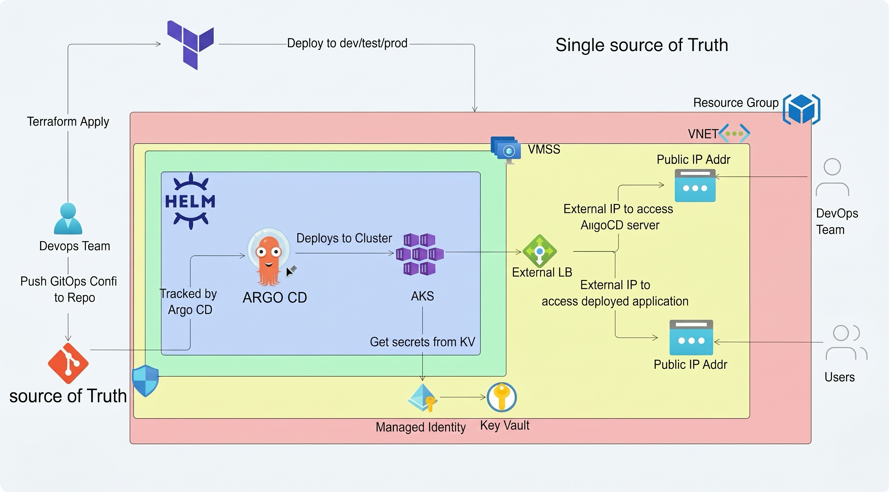
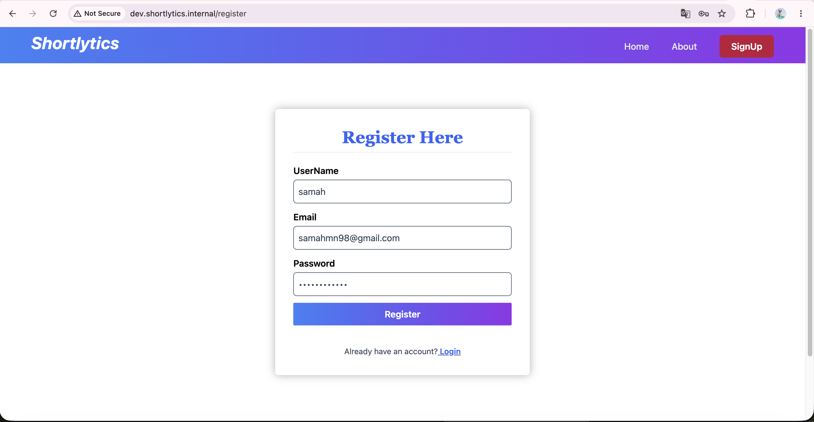
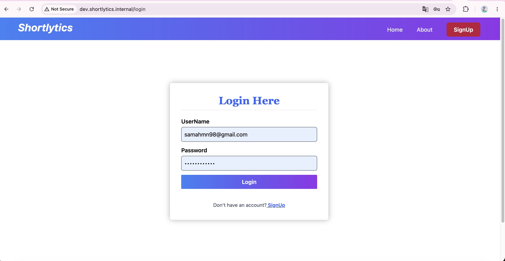
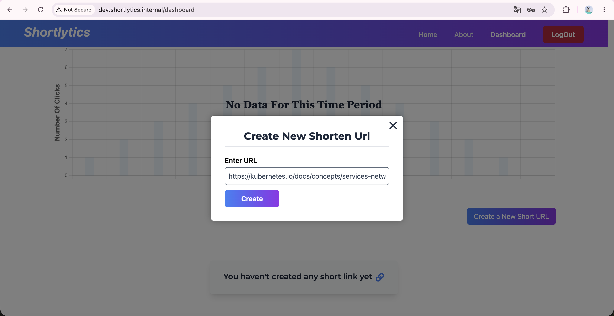
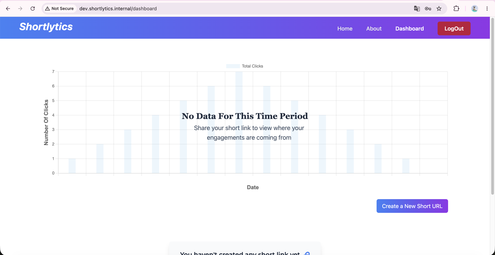
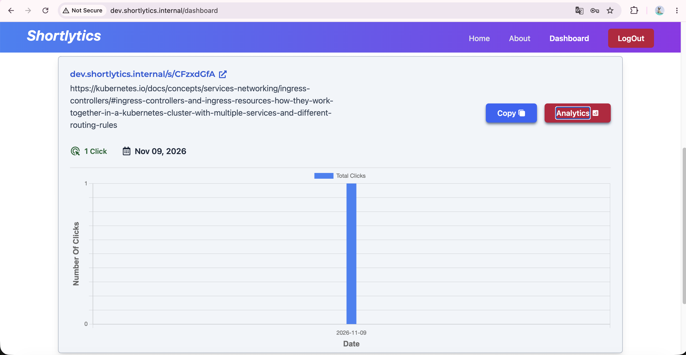
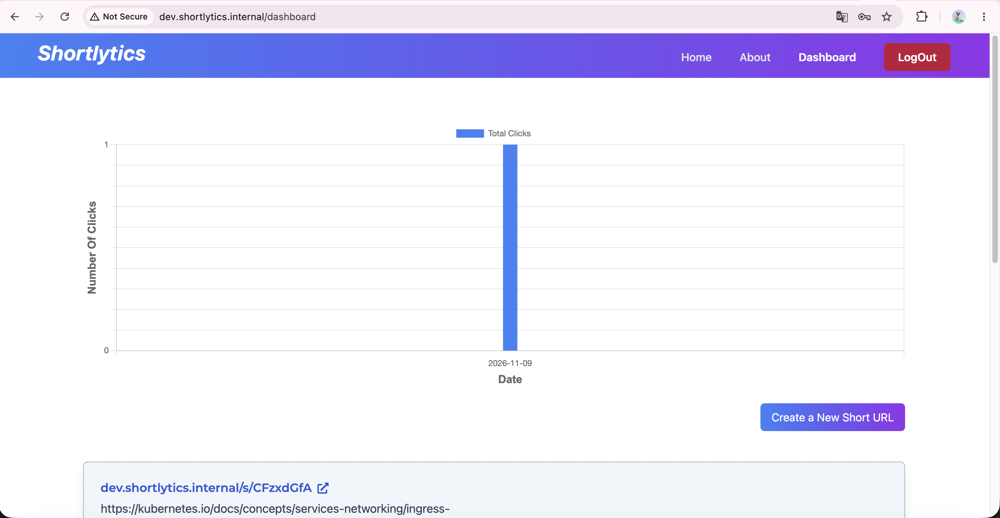
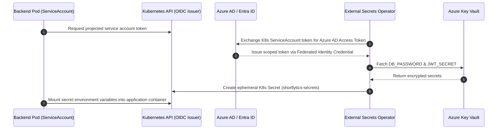
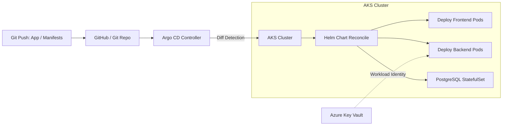
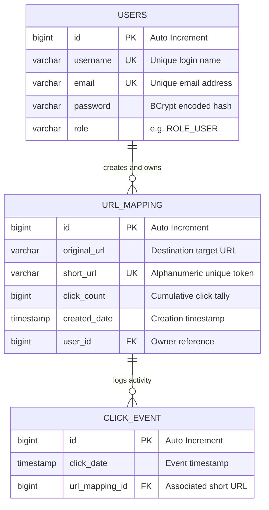

# 🔗 Shortlytics

> **An enterprise-grade, cloud-native URL shortener and click-analytics platform built with Spring Boot, React, and PostgreSQL, deployed on Azure Kubernetes Service (AKS) via Terraform and GitOps (Argo CD).**

[](https://openjdk.org/)
[](https://spring.io/projects/spring-boot)
[](https://react.dev/)
[](https://vitejs.dev/)
[](https://tailwindcss.com/)
[](https://www.postgresql.org/)
[](https://www.terraform.io/)
[](https://azure.microsoft.com/services/kubernetes-service/)
[](https://argoproj.github.io/cd/)

---

## 📑 Table of Contents

- [Overview](#-overview)
- [System Architecture](#-system-architecture)
- [Visual Tour & Key Features](#-visual-tour--key-features)
  - [1. Authentication & Security](#1-authentication--security)
  - [2. URL Creation & Link Management](#2-url-creation--link-management)
  - [3. Click Analytics & Observability](#3-click-analytics--observability)
- [Architecture Deep Dive](#-architecture-deep-dive)
  - [Zero-Trust Secret Management](#zero-trust-secret-management-workload-identity)
  - [GitOps Deployment Flow](#gitops-deployment-pipeline)
  - [Dual-Layer Analytics Strategy](#dual-layer-analytics-strategy)
- [Database Schema & ERD](#-database-schema--erd)
- [REST API Reference](#-rest-api-reference)
- [Tech Stack Breakdown](#-tech-stack-breakdown)
- [Getting Started](#-getting-started)
  - [Local Development](#local-development)
  - [Azure Cloud Deployment (IaC + GitOps)](#azure-cloud-deployment-iac--gitops)
- [Repository Structure](#-repository-structure)

---

## 🌟 Overview

**Shortlytics** is a resilient URL shortening and telemetry platform designed with modern distributed systems principles. It moves beyond standard toy shorteners by implementing:

- **Stateful Event Telemetry:** Tracking individual click events with millisecond-precision timestamps alongside aggregate counters.
- **Strict Cloud-Native Security:** Complete elimination of static database credentials and API secrets in cluster manifests using **Azure Workload Identity** and **External Secrets Operator (ESO)**.
- **Declarative GitOps Delivery:** Automated continuous reconciliation and self-healing deployments orchestrated by **Argo CD** through modular Helm charts.
- **Enterprise Infrastructure as Code:** Modular **Terraform** architecture managing Azure Virtual Networks, AKS, Azure Container Registry (ACR), and Azure Key Vault.

---

## 🏗️ System Architecture

The following diagram captures the complete end-to-end cloud infrastructure, continuous delivery pipeline, and runtime traffic topology:

<p align="center">
  
</p>

### Architecture Highlights

1. **Ingress & Routing:** External web traffic enters via Azure Load Balancer to **NGINX Ingress Controller**, routing UI requests to the React frontend and `/api/*` / `/{shortUrl}` calls to the Spring Boot cluster.
2. **Micro-workloads & Scaling:** Frontend and Backend pods run under Kubernetes Horizontal Pod Autoscalers (HPA) inside isolated namespaces (`shortlytics-dev` / `shortlytics-prod`).
3. **Database Isolation:** PostgreSQL is protected via Kubernetes **NetworkPolicies**, accepting connections solely from authorized backend pods on port 5432.
4. **Zero-Secret Footprint:** Pods assume an **Azure User-Assigned Managed Identity** through Federated OIDC tokens; the External Secrets Operator pulls sensitive values straight from **Azure Key Vault** into ephemeral in-memory Kubernetes secrets.
5. **GitOps Synchronization:** Argo CD continuously tracks changes in the `gitops-manifests/` directory and synchronizes Kubernetes resource state with zero manual `kubectl` intervention.

---

## 📸 Visual Tour & Key Features

### 1. Authentication & Security
User authentication is backed by **Spring Security** with stateless **JWT tokens** and salted **BCrypt** password hashing.

| Registration Flow | Secure Login |
| :---: | :---: |
|  |  |
| *New user account creation with client & server-side validation* | *JWT authentication returning secure authorization credentials* |

---

### 2. URL Creation & Link Management
Authenticated users can generate unique short identifiers for any destination URL, with instant clipboard copying, URL deletion, and quick status overviews.

| Modal: Create Short URL | Dashboard: Link Manager |
| :---: | :---: |
|  |  |
| *Interactive modal validating destination URLs with real-time feedback* | *Centralized dashboard tracking all user links, short codes, and click sums* |

---

### 3. Click Analytics & Observability
Every redirection performs an audit click capture. Shortlytics delivers both overall portfolio performance metrics and per-link granular timeseries charts built with **Chart.js**.

| Total Portfolio Performance | Per-Link Granular Click Analytics |
| :---: | :---: |
|  |  |
| *Aggregated daily click trends across all shortened URLs* | *Detailed temporal timeline tracking individual click surges over time* |

---

## 🔬 Architecture Deep Dive

### Zero-Trust Secret Management (Workload Identity)

Shortlytics adheres strictly to the principle of least privilege. No passwords, database URLs, or JWT secrets are stored in Git, Docker images, or CI/CD pipelines.



### GitOps Deployment Pipeline

Deployments follow a strictly declarative model. Code pushes to Git trigger automated container packaging, followed by GitOps reconciliation:



### Dual-Layer Analytics Strategy

To achieve both **sub-millisecond redirection** and **rich timeseries analytics**, the system employs a dual-write model upon each redirection request (`GET /{shortUrl}`):

1. **Fast-path Counter (`click_count`):** A lightweight atomic increment on the `url_mapping` table powers high-volume dashboard reads with zero query joins ($O(1)$ complexity).
2. **Audit Event Log (`ClickEvent`):** An append-only historical log entry capturing timestamp metadata, enabling granular temporal charts, range filters, and anomaly detection.
3. **HTTP 302 vs 301 Semantics:** The redirection endpoint intentionally returns `302 Found` (temporary redirect) rather than `301 Moved Permanently`. This prevents client browsers from caching the destination locally, ensuring every click registers on the telemetry collector.

---

## 🗄️ Database Schema & ERD

The relational data model is managed via **Flyway migrations** (`db/migration/V1__*.sql`), strictly decoupled from JPA auto-generation (`spring.jpa.hibernate.ddl-auto=validate`).



---

## 🔌 REST API Reference

All protected endpoints require an `Authorization: Bearer <JWT>` header.

| Method | Endpoint | Access | Description |
| :--- | :--- | :---: | :--- |
| `POST` | `/api/auth/public/register` | Public | Register a new user account |
| `POST` | `/api/auth/public/login` | Public | Authenticate credentials and receive a JWT token |
| `POST` | `/api/urls/shorten` | User | Generate a short code for a provided original URL |
| `GET` | `/api/urls/myurls` | User | List all short URLs created by the authenticated user |
| `GET` | `/api/urls/analytics/{shortUrl}` | User | Retrieve temporal click timeseries for a specific short link |
| `GET` | `/api/urls/totalClicks` | User | Retrieve aggregated daily click sums for the user's links |
| `GET` | `/{shortUrl}` | Public | Core redirect engine — records click and issues HTTP `302 Found` |

---

## 💻 Tech Stack Breakdown

### Application Services
- **Backend:** Java 23, Spring Boot 3.4.0, Spring Security (Stateless JWT), Spring Data JPA, Hibernate, Flyway.
- **Frontend:** React 18, Vite 6, Tailwind CSS, Material UI (MUI), Chart.js & React-ChartJS-2, Axios, React Hook Form, Framer Motion.
- **Database:** PostgreSQL 16 (StatefulSet with PersistentVolumeClaims on Azure Disks).

### Cloud & DevOps Infrastructure
- **Cloud Provider:** Microsoft Azure (West Europe / East US).
- **Compute:** Azure Kubernetes Service (AKS) with Azure CNI networking.
- **Infrastructure as Code:** Terraform with remote state locking on Azure Blob Storage.
- **GitOps & Delivery:** Argo CD, Helm 3 umbrella charts (`values-dev.yaml`, `values-prod.yaml`).
- **Identity & Secrets:** Azure AD Workload Identity, External Secrets Operator (ESO), Azure Key Vault.
- **Networking & Ingress:** NGINX Ingress Controller, Jetstack cert-manager for TLS.
- **Observability:** Spring Boot Actuator, Micrometer Prometheus metrics, Kubernetes Liveness & Readiness Probes.

---

## 🚀 Getting Started

### Local Development

#### Prerequisites
- **JDK 23+**
- **Node.js 20+** & **npm**
- **PostgreSQL 15+** running locally (default port: `5432`)

#### 1. Setup Database
```bash
psql -U postgres -c "CREATE DATABASE url_shortener_db;"
```

#### 2. Run Backend
```bash
cd backend

# Configure environment variables
export DB_URL="jdbc:postgresql://localhost:5432/url_shortener_db"
export DB_USERNAME="postgres"
export DB_PASSWORD="your_password"
export JWT_SECRET="your_secure_256bit_jwt_secret_key_minimum_length_required"
export JWT_EXPIRATION="86400000"

# Compile and start application (Flyway runs schema migrations automatically)
./mvnw spring-boot:run
```
The backend API initializes on `http://localhost:8080`.

#### 3. Run Frontend
```bash
cd frontend
npm install
npm run dev
```
Access the client UI at `http://localhost:5173`.

---

### Azure Cloud Deployment (IaC + GitOps)

#### 1. Infrastructure Provisioning via Terraform
```bash
# Initialize remote state storage backend
cd terraform/bootstrap
terraform init && terraform apply -auto-approve

# Deploy AKS, VNet, Key Vault, and ACR
cd ../environments/dev
terraform init
terraform plan -out=dev.tfplan
terraform apply dev.tfplan
```

#### 2. Bootstrap Cluster & GitOps
Run the automated deployment script to establish cluster credentials, namespaces, Ingress NGINX, Cert-Manager, External Secrets, and Argo CD:

```bash
chmod +x deploy-shortlytics-aks.sh
./deploy-shortlytics-aks.sh
```

Argo CD will automatically sync the `gitops-manifests/apps/dev/shortlytics-app.yaml` application manifest and orchestrate all pod rollouts.

---

## 📁 Repository Structure

```text
url-shortner-java/
├── backend/                       # Spring Boot 3.4 REST Application
│   ├── src/main/java/             # Domain models, Controllers, Services, Security
│   ├── src/main/resources/        # Application config & Flyway migrations (db/migration)
│   └── pom.xml                    # Maven configuration & dependencies
├── frontend/                      # React 18 + Vite SPA
│   ├── src/components/            # Dashboard, Graph, ShortenModal, Navbar
│   ├── src/hooks/                 # Custom React hooks & state helpers
│   ├── package.json               # Dependencies (Tailwind, MUI, Chart.js)
│   └── vite.config.js             # Vite bundler configuration
├── gitops-manifests/              # Declarative Kubernetes Manifests & Helm Charts
│   ├── apps/                      # Argo CD Application CRDs (dev / prod)
│   └── shortlytics/               # Helm Umbrella Chart
│       ├── charts/backend/        # Backend Deployment, HPA, SecretStore, ESO
│       ├── charts/frontend/       # Frontend Deployment, Service, HPA
│       ├── templates/             # Ingress, NetworkPolicies, PostgreSQL StatefulSet
│       ├── values-dev.yaml        # Dev environment overrides
│       └── values-prod.yaml       # Prod environment overrides
├── terraform/                     # Infrastructure as Code
│   ├── bootstrap/                 # State storage account & resource group
│   ├── environments/              # Environment configurations (dev / prod)
│   └── modules/                   # Reusable modules (compute, network, security)
├── images/                        # Architecture & UI screenshots
│   ├── image.png                  # System Architecture diagram
│   ├── register1.png              # Registration screen
│   ├── login1.png                 # Login screen
│   ├── create_url.png             # Shorten URL dialog
│   ├── dashboard1.png             # Main user dashboard
│   ├── analytics1.png             # Global analytics charts
│   └── analytics2.png             # Granular click breakdown
├── deploy-shortlytics-aks.sh      # Automated AKS & GitOps bootstrap script
├── setup-argocd-secrets.sh        # Cluster secret bootstrapping helper
└── README.md                      # Project documentation
```

---


